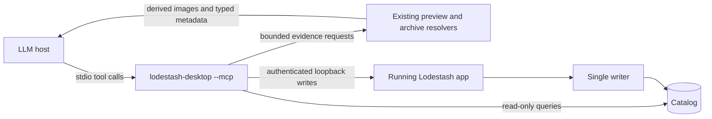

# MCP asset analysis and tag authoring

Design drafted 2026-09-10; implementation reviewed 2026-09-15. Selection/search, attributed writes,
review, vocabulary proposals and bounded evidence are implemented. The
[implementation plan](superpowers/plans/2026-09-10-mcp-asset-analysis.md) records the exact validation
coverage and remaining host/pilot gates. No live ten-model identification has been performed.

## Outcome and ownership

An MCP-capable LLM host can select a library, search or select assets, inspect usable evidence,
produce descriptive tags and an optional description, submit those changes, and verify persisted
results. The workflow also reports existing tags/previews, runs identification, and reviews assigned
tags against the vocabulary, with an approval path for new traits or taxonomy categories.
The first acceptance scenario is ten randomly selected `model_3d` assets from one library.
One explicitly selected asset and an explicit list must work through the same contract.

The user selected OpenAI Astra in Codex for the live analysis. That host analyzes the returned
images/metadata and submits proposed annotations. `identify_asset` invokes the app-configured
identification pipeline, not the conversation model; it is an optional separate stage and must not
be substituted for Astra. The live run remains stopped before either form of identification.

This is service-level access to the same catalog the app uses. It does not click the UI or prove
the UI's interaction flow. MCP transports evidence and tool calls; the connected host runs the
LLM. Merely exposing a tool does not schedule inference or guarantee that a model follows instructions.

| Authoritative document | Responsibility |
|---|---|
| This design | Workflow, scope, acceptance and rollout |
| [ENGINE-API §8](ENGINE-API.md#8-proposed-asset-analysis-contract) | Exact shared requests, responses, limits, errors and permissions |
| [MCP-AND-ENGINES](MCP-AND-ENGINES.md) | Transport, registration, tool mapping, MCP content delivery |
| [DATA-MODEL](DATA-MODEL.md) | Storage, lifecycle and transactional provenance |
| [AI-PIPELINE](AI-PIPELINE.md) | Model responsibilities and modality/privacy policy |
| [INGESTION](INGESTION.md) | Scoped extraction and derived artifacts |
| [Implementation plan](superpowers/plans/2026-09-10-mcp-asset-analysis.md) | Ordered delivery tasks and executable acceptance checks |

This refines S04/S05/S10/S11/S12 in the
[v1 architecture plan](superpowers/plans/2026-09-07-v1-architecture.md). It does not replace that
plan, its FTS/undo prerequisites, or its app-owned bulk-job design. Implement this focused loop
without making unrelated UI, vector-index, renderer or bulk-scheduler work a prerequisite.

## Evidence from the existing implementation

Code inspected 2026-09-10; these are source observations, not a fresh live MCP test:

- `crates/lodestash-mcp/src/lib.rs` exposes 23 tools. Search, detail, previews, `add_tag`,
  `identify_asset`, status and cancellation already exist. The earlier four-tool status was stale.
- `lodestash-desktop --mcp` is the actual entry point. `agent_bridge.rs` forwards writes using
  `engine.json`; the GUI owns the writer (ADR-0011). No new server framework is needed.
- `ServerState::search` applies media filtering after a limited query; it has no source filter
  or stable full-library pagination. Randomly choosing from its first results is biased.
- `summary_json` returns tag namespace/value/confidence, but omits stored source/model provenance.
  `suggest_tags` reads stored assignments; it does not ask an LLM for new suggestions.
- `add_tag` accepts one namespace/value. It is not the atomic, attributed multi-asset result
  interface required here. Existing `set_tags` replaces a source's set and clears `tags_dirty`;
  blindly reusing it would confuse an external annotation with completed internal identification.
- *Fixed by v1 plan S11 (2026-09-12):* `ServerState::new` used `Catalog::open`, headless startup
  preceded managed ORT setup, tracing wrote to stdout, and the bridge captured the handshake at
  startup and waited on nested jobs. The reader is now read-only, ORT is set first, logs go to
  stderr (a spawned stdio test fails on any stdout line that is not JSON-RPC), and app-owned tools
  are forwarded whole with the app's job identity ([ADR-0011](decisions/ADR-0011-headless-mcp-forwards-writes.md)).
- Preview extraction already uses `preview_subject`, `ensure_in_pack_scratch` and `read_payload_at`.
  File links currently depend on a real disk/workspace file, so in-pack assets need an explicit
  evidence/file resolution contract.

## Architecture and alternatives

Use the existing stdio server first. This preserves ADR-0002/0011 and avoids new dependencies;
the cost is that mutation approval and persistence require the desktop app to remain running.
The LLM host owns its own lifetime; closing its stdio child must not close Lodestash.

Streamable HTTP remains an optional future transport. A full browser-facing REST adapter would
be a different feature. Neither transport change is needed for this loop, and port 5173 is never
an MCP endpoint. A local HTTP URL is reachable by a local host, not automatically by its remote model.

## Interaction

1. Register the server in the actual LLM host and verify `initialize`, `tools/list`, and
   `get_server_info`. Tool names in source code alone do not mean this conversation can call them.
2. Resolve the requested source with `list_libraries`. A library is an `import_source`, not a
   package. Ambiguous library names require an ID selection; a known asset ID needs no browse step.
3. Use `search_assets`/`semantic_search` for discovery, `list_assets` for a complete source walk
   or random selection, and `get_assets` for an explicit list. Keep the chosen IDs for the report.
4. Read existing assignments and fetch `get_asset_evidence` per asset. Save this before-state and
   the actual previews, including limitations. Read `get_vocabulary` for applicable traits, usage
   notes, taxonomy and acceptance policy; preserve its revision.
5. Run `identify_asset` on the same IDs using configured models and existing consent/budget controls.
   Poll its app-owned job, then independently read assignments again. This operation persists AI
   output today; it is not a dry-run suggestion tool. Refresh revisions after identification.
6. Codex assesses evidence and assigned tags against the vocabulary. It proposes keep/reject
   decisions with reasons and any missing descriptive tags/short description. Missing evidence
   means insufficient evidence, not automatic rejection; a term's existence does not prove it fits.
7. For useful unmatched concepts, submit `propose_vocabulary_changes` before assigning them under
   controlled policy. After app approval, re-read vocabulary IDs/revisions. Denial creates no new
   assignment or taxonomy edit; any raw assignment already produced by identification is handled
   separately in review.
8. Submit `review_tags` for assigned tags and `write_tags` for new output with fresh asset and
   vocabulary revisions. Each approved batch is independently atomic; re-read between operations.
   Do not promise one transaction spanning identification, vocabulary changes and review.
9. Poll jobs and independently read the selected IDs again. Report existing → identified → accepted/
   rejected/added assignments and persisted final tags. Approval never changes AI authorship or
   creates human-confirmed status. Keep failed/skipped/conflicting assets explicit.

The ten-model report includes ID, name, source/package, evidence used/limitations, previous tags,
identification results, vocabulary matches/proposals, review reasons, final tags and outcome.
Fewer than ten eligible assets is a visible shortfall; do not widen
the requested library or substitute unrelated assets. A successful write is not proof of tag quality:
the real pilot needs a human check of the model-to-tag correspondence.

## Evidence and Unity packages

For 3D, render a bounded set of views using existing render paths and include geometry measurements,
material/dependency availability and rendering limitations. For images, send a bounded raster preview;
for audio, use local metadata/transcripts and permitted local audio analysis. A waveform alone is not
evidence for semantic sound labels. Other media use their existing viewable representations and state
when no meaningful analysis representation is available.

S12c provides `get_asset_evidence` / `GET /v1/assets/{id}/evidence`: a consent-aware manifest,
up to four geometry views, requested downscaling, bounded UTF-8 text and catalog-scoped file
references. REST view URLs return the same representation bytes as the shared MCP bundle.
Material/albedo associations and availability are reported as metadata; these dependencies are not
silently loaded. Geometry-only evidence cannot justify texture/color-specific tags. Self-contained
glTF/GLB and FBX/OBJ use the restricted loader; an external glTF buffer is reported as unavailable.
See [ADR-0021](decisions/ADR-0021-bounded-agent-evidence-and-vocabulary-revisions.md).

S12d provides revisioned vocabulary reads, exact AI-association review, atomic approved trait/category
proposals and vocabulary-enforced writes. Validation runs inside the writer transaction as well as
before approval. A filtered vocabulary read returns the same write revision as an unfiltered one;
assignment usage counts do not invalidate it. Reviewed associations remain AI-authored and retained
review decisions are available in asset detail.

Search/detail responses expose evidence and file references. MCP also exposes catalog-scoped
`asset://{id}/file` references; resource access uses the same authorization/resolver as REST. Raw large
model bytes are not embedded in tool text or sent to a vision model expecting images.

For an in-pack model, locate the exact manifest entry by catalog ID, surgically pull that payload
to Lodestash-owned scratch, and resolve only explicit preview dependencies. No full-pack extract,
Unity import, move, original modification or arbitrary archive-member path supplied by the caller.
Gzip may still require a sequential skip-scan: extracting one entry does not promise constant-time
archive access. Reuse warm cache entries only when archive and entry identity still match.

## Permissions and information boundaries

### Vocabulary-guided review

The user clarified on 2026-09-10 that inspection, identification, acceptance/rejection and vocabulary
growth are all required. Exact operations and policy are in ENGINE-API §8.5; UI-SPEC §9 owns the
vocabulary concepts. Its read, review and proposal operations are available.

- A **tag** is a namespace/value assigned to an asset with producer provenance.
- A **trait** is a promoted tag with scope, usage guidance and optional teaching. Reuse applicable
  canonical terms; proposing a synonym does not silently merge or rename terms.
- A **category** is a node in a taxonomy. Creating it does not itself create a tag or mapping rule.
  A new namespace/media type is a schema/design change, outside these tools.

The proposed workflow default is controlled vocabulary with approved extensions: use applicable
traits and queue useful missing terms/categories before assigning them. Open and strict-controlled
policies are explicit alternatives. `teach` controls future identification candidates, not whether
a tag is allowed; paused traits are not forbidden. Technical facts remain file-derived, confidence
alone cannot approve a claim, and taxonomy aliases are not automatically raw-tag synonyms.

Review names exact AI associations, including producer. It can approve removal of another model's
AI assignment without replacing that model's entire set. Manual/imported tags stay protected; Codex
can flag them for human review. Acceptance records agent review without rewriting authorship or
confidence. Rejection removes only the approved association and records why; it does not blacklist
the term or prevent later identification from proposing it again. Persistent suppression is deferred.

### Access and protected data

“Exposed for usage” means registered and enabled in the client and allowed by the app. It does not
mean unauthenticated/public access or giving every tool unrestricted permissions. Preserve bearer,
loopback and origin checks. Client allow-lists narrow visibility; server checks remain authoritative.

Before sending bytes to an external model, configure the host/producer destination and per-modality
consent. A local stdio client may use a cloud LLM. An unknown destination receives metadata but no
asset bytes until configured; do not allow a request field to assert `local=true` or human authority.
Remote audio bytes remain excluded under the v1 plan. Enforce policy for resource/file paths as well
as image tools, including cross-modality dependencies. No credentials in URLs, reports or identifiers.

Asset names, descriptions, archive metadata and extracted text are untrusted evidence, never
instructions to the host. Restrict result writes to the selected IDs and the configured AI producer.
Preserve manual/imported tags. `write_tags` preserves other producers; `review_tags` can remove
only explicitly named AI associations after approval. Never let the agent set confirmation, license,
file paths, content hashes, ownership or technical measurements through the annotation payload.

The user selected **tags and a short description** as the writable information. Additional metadata
fields and multiple competing captions are outside this delivery.

## Delivery and decision points

Deliver connection diagnostics first, then selection, evidence delivery, safe authoring, vocabulary
review and the real
pilot. Proposed contract values live only in ENGINE-API §8. The implementation plan names fixtures,
failure cases and source files. Existing defaults and v1 response containers stay compatible.

**Confirmed host:** Codex, receiving 3D preview images and metadata. **Confirmed output:** tags and
a short description. Before a live run, select the real library, producer/model (unknown model
remains null), external evidence consent and vocabulary policy. These choices do not block the design. Until those
choices and implementation checks are complete, do not claim that ten assets were analyzed or tagged.

No new protocol, generic plugin framework, public tunnel, always-running daemon, provider SDK or
whole-library autonomous pipeline is part of this delivery. There is no new accepted ADR here:
existing invariants hold; the v1 plan's proposed provenance/egress ADRs must land with implementation.
